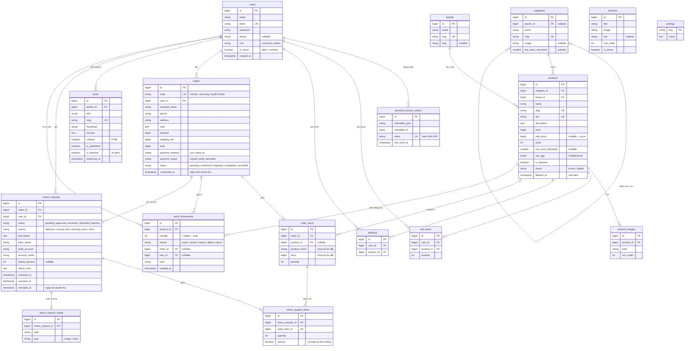

# Cơ sở dữ liệu (ERD)

Sơ đồ lấy từ các migration trong `backend/database/migrations`. Hệ quản trị: MySQL (utf8mb4). Tiền lưu dạng số nguyên VND (`unsigned bigint`), không có số lẻ.

Không vẽ các bảng hạ tầng của Laravel: `password_reset_tokens`, `sessions`, `cache`, `jobs`. Bảng `personal_access_tokens` (token đăng nhập Sanctum) có vẽ.

## Sơ đồ

`posts`, `banners`, `settings` không có khoá ngoại tới bảng khác ngoài `posts.author_id → users`.

Chatbot không có bảng riêng: bot đọc dữ liệu có sẵn (sản phẩm, đơn hàng, cài đặt), còn lịch sử trò chuyện chỉ nằm ở trình duyệt (`sessionStorage`).

## Mô tả các bảng

| Bảng | Vai trò |
|---|---|
| `users` | Tài khoản khách và admin. `role` phân quyền, `is_active = false` thì không đăng nhập và không gọi API được. |
| `personal_access_tokens` | Token Sanctum. Mỗi lần đăng nhập tạo một token, đăng xuất thì xoá. |
| `categories` | Danh mục 2 cấp (`parent_id`). Có thể đặt ngưỡng sắp hết hàng riêng cho cả danh mục. |
| `brands` | Thương hiệu (Bandai, LEGO, Good Smile…). |
| `products` | Sản phẩm. `sale_price` là giá khuyến mãi; giá bán thực tế = `sale_price` nếu có, không thì `price`. `description` là HTML đã lọc (có thể chứa ảnh nằm ở `storage/app/public/products/content`). Xoá mềm để đơn cũ vẫn tra được. |
| `product_images` | Nhiều ảnh mỗi sản phẩm, sắp xếp bằng `sort_order` (ảnh đầu là ảnh đại diện). |
| `cart_items` | Giỏ hàng lưu trên server theo tài khoản, mỗi sản phẩm một dòng. |
| `wishlists` | Danh sách yêu thích. |
| `orders` | Đơn hàng: thông tin nhận hàng, tiền, phương thức và trạng thái thanh toán, trạng thái đơn. |
| `order_items` | Dòng hàng. Lưu lại tên và giá lúc đặt, nên sửa hoặc xoá sản phẩm sau này không làm đổi đơn cũ. |
| `stock_movements` | Nhật ký mọi lần tồn kho thay đổi. Tồn kho hiện tại của một sản phẩm luôn bằng tổng `change` của nó. |
| `return_requests` | Yêu cầu trả hàng của khách cho một đơn đã hoàn thành, kèm tài khoản nhận tiền hoàn. |
| `return_request_items` | Sản phẩm và số lượng khách trả. Khi nhận hàng, admin chọn có nhập lại kho hay không (`restock`). |
| `return_request_media` | Ảnh và video minh chứng (tối đa 5 file; ảnh ≤ 5 MB, video ≤ 50 MB). |
| `posts` | Bài viết NEWS, nội dung HTML soạn bằng trình soạn thảo. Một bài được ghim làm tin nổi bật. |
| `banners` | Ảnh slider ở trang chủ. |
| `settings` | Cài đặt admin sửa được (tài khoản nhận tiền VietQR, số hotline, ngưỡng sắp hết hàng chung). Giá trị trong bảng ưu tiên hơn `.env`. |

## Ràng buộc đáng chú ý

- **Duy nhất:** `users.email`, `products.slug` và `products.sku`, `orders.code`, cặp (`user_id`, `product_id`) ở `cart_items` và `wishlists`, cặp (`return_request_id`, `order_item_id`).
- **Không cho xoá khi còn dữ liệu phụ thuộc (restrict):**
  - danh mục hoặc thương hiệu đang có sản phẩm;
  - người dùng đã có đơn;
  - sản phẩm đã có lịch sử kho;
  - đơn đã có yêu cầu trả hàng.

  Admin muốn ẩn sản phẩm thì dùng `status = hidden` hoặc xoá mềm.
- **Xoá theo (cascade):** xoá sản phẩm thì xoá ảnh, dòng giỏ, dòng yêu thích; xoá đơn thì xoá dòng hàng.
- **Đặt null:** `order_items.product_id` và `stock_movements.order_id`, `user_id`, để giữ lịch sử khi bản ghi gốc mất.
- **Chỉ mục:** `products.price`, `min_age`, `status` (bộ lọc); `orders.status` và (`status`, `completed_at`) (dashboard); `return_requests.refunded_at`; `posts` (`is_published`, `published_at`).
