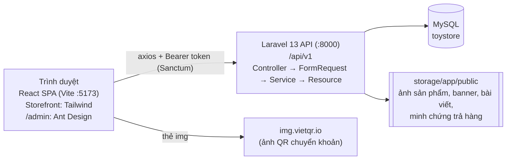
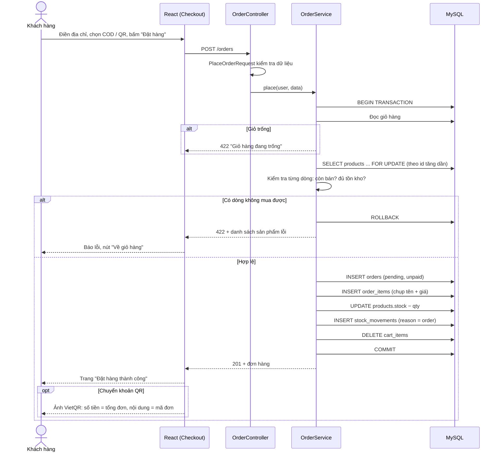
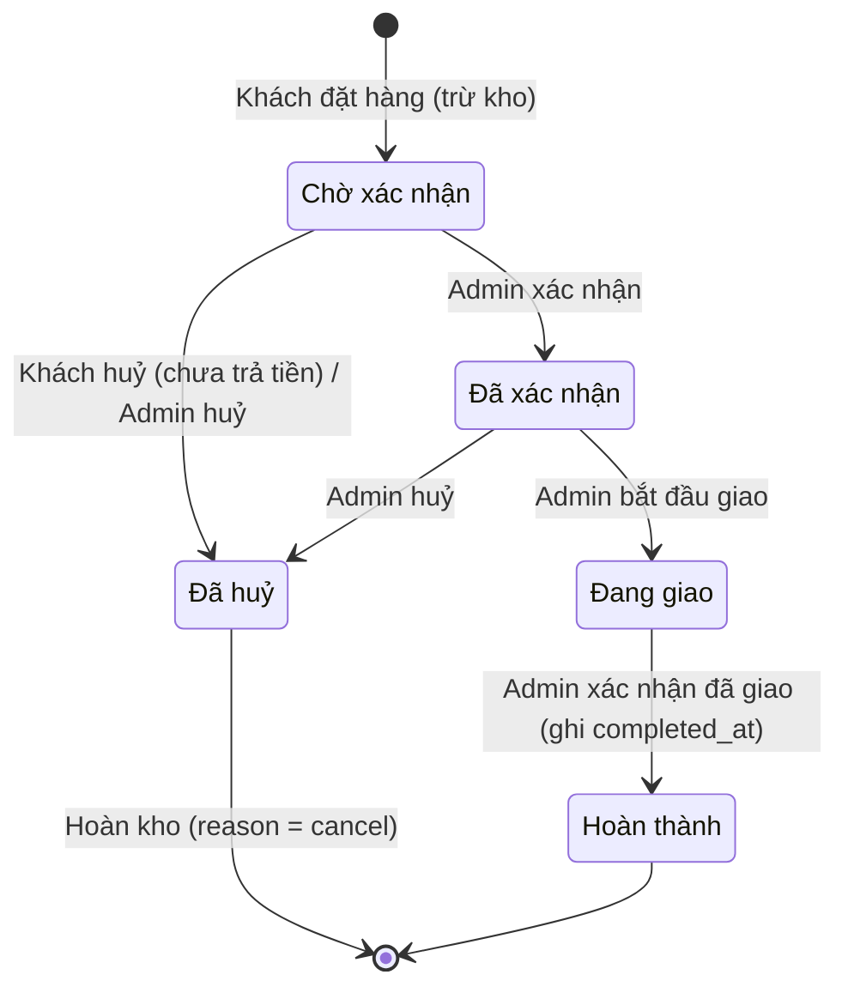
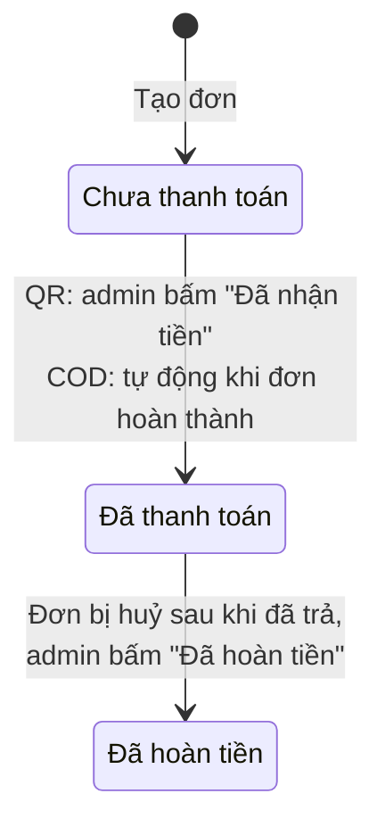
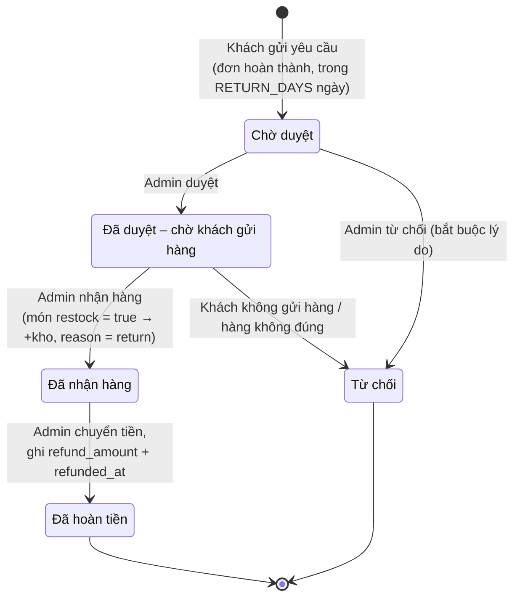
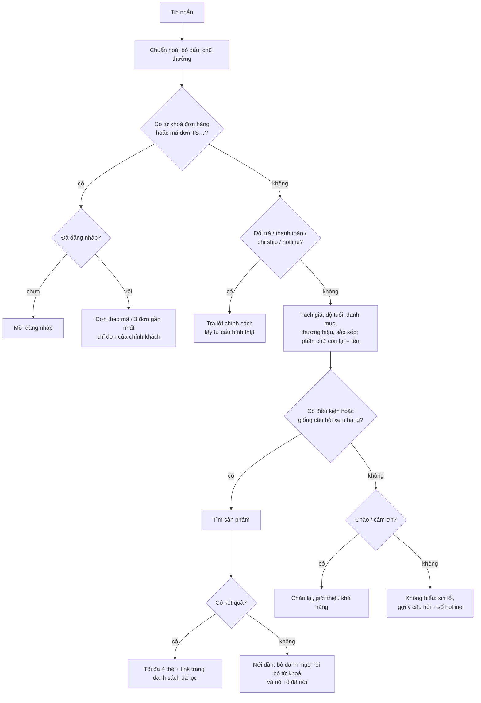

# Luồng nghiệp vụ và sơ đồ trạng thái

## 1. Kiến trúc tổng quan



Toàn bộ chạy trên máy cục bộ, không gọi dịch vụ trả phí nào (chatbot cũng tự xử lý trong Laravel). Dịch vụ ngoài duy nhất là ảnh QR của VietQR, trình duyệt tải trực tiếp.

- Controller chỉ nhận request và trả response.
- Kiểm tra dữ liệu nằm ở FormRequest.
- Nghiệp vụ có nhiều bước nằm trong Service: `OrderService`, `StockService`, `ReturnService`, `CartService`, `DashboardService`, `ChatbotService`.
- Mọi thao tác đổi tồn kho, tiền hoặc trạng thái chạy trong `DB::transaction` và khoá dòng (`lockForUpdate`) trước khi đọc trạng thái mới nhất.

## 2. Luồng đặt hàng



Hai điểm quan trọng khi bảo vệ:

- **Chống bán vượt kho:** sản phẩm bị khoá dòng tới hết transaction. Hai khách cùng mua món cuối thì người đến sau phải chờ, đọc lại tồn kho (lúc này đã bằng 0) và nhận lỗi. Khoá theo thứ tự id tăng dần để hai đơn đồng thời không khoá chéo nhau (deadlock).
- **Chụp giá:** `order_items` lưu tên và giá lúc đặt. Sửa giá hay xoá sản phẩm sau đó không làm đổi đơn cũ hay doanh thu cũ.

## 3. Trạng thái đơn hàng



- Quy tắc nằm ở `OrderStatus::allowedNext()`. Mọi chuyển trạng thái khác đều bị từ chối (422).
- Đơn **Đang giao** không huỷ được.
- Khách chỉ huỷ được đơn **Chờ xác nhận** chưa thanh toán. Đơn đã thanh toán phải để cửa hàng huỷ, để không quên hoàn tiền.

## 4. Trạng thái thanh toán



- Hệ thống **không** tự đối soát ngân hàng. Admin kiểm tra tài khoản, thấy tiền về đúng mã đơn thì bấm xác nhận.
- Đơn **Đã huỷ** mà còn **Đã thanh toán** được đếm là "cần hoàn tiền" trên dashboard cho tới khi admin ghi nhận đã hoàn.
- Tiền hoàn của yêu cầu trả hàng ghi ở `return_requests.refund_amount`, không đổi `payment_status` của đơn.

## 5. Trạng thái yêu cầu trả hàng



- Mỗi đơn chỉ có **một** yêu cầu đang mở tại một thời điểm.
- Tổng số lượng trả của một dòng hàng không vượt số đã mua.
- **Số tiền hoàn:** mặc định = tiền hàng các món trả (không gồm phí ship). Tối đa = tổng đơn trừ các lần đã hoàn trước.

## 6. Quy ước tính doanh thu

**Doanh thu = tổng `total` của các đơn _Hoàn thành_ và _Đã thanh toán_, tính vào ngày `completed_at`, trừ `refund_amount` của các yêu cầu trả hàng, tính vào ngày `refunded_at`.**

- Đơn chưa hoàn thành, kể cả đã chuyển khoản, chưa được tính, vì còn có thể bị huỷ.
- Đơn huỷ không bao giờ được tính.
- Tiền hoàn trả hàng bị trừ vào **ngày hoàn tiền**, không sửa ngược số liệu ngày bán. Báo cáo của tháng đã chốt không bị thay đổi về sau.
- "Hôm nay", "tháng này", "30 ngày", "12 tháng" tính theo giờ cửa hàng (`SHOP_TIMEZONE`, mặc định `Asia/Ho_Chi_Minh`). Ranh giới ngày là 0h giờ Việt Nam.

Mã nguồn: `app/Services/DashboardService.php`.

## 7. Tồn kho và ngưỡng sắp hết hàng

- Mọi thay đổi tồn kho đều đi qua `StockService` và ghi một dòng `stock_movements`, nên luôn có `products.stock = SUM(stock_movements.change)`. Seeder dữ liệu demo có test kiểm tra điều này.

| Lý do (`reason`) | Khi nào | Dấu |
|---|---|---|
| `order` | Đặt hàng | − |
| `cancel` | Huỷ đơn, hoàn kho | + |
| `import` | Admin nhập kho | + |
| `adjust` | Admin điều chỉnh (kiểm kê, hỏng…), bắt buộc ghi chú | ± |
| `return` | Nhận hàng trả về, món còn bán được | + |

- **Ngưỡng "sắp hết hàng"** của một sản phẩm, lấy giá trị đầu tiên có đặt:
  1. ngưỡng riêng của sản phẩm (`products.low_stock_threshold`);
  2. ngưỡng của danh mục chứa nó;
  3. ngưỡng của danh mục cha;
  4. ngưỡng chung ở **Admin → Cài đặt**; nếu chưa lưu thì dùng `LOW_STOCK_THRESHOLD` trong `.env` (mặc định 5).

  Sản phẩm có `0 < stock ≤ ngưỡng` là sắp hết; `stock = 0` là hết hàng.

## 8. Chatbot hỗ trợ khách

Chatbot trả lời theo kịch bản, **không dùng AI**: không tốn phí, không cần khoá API, không cần mạng ngoài, và chỉ trả lời bằng dữ liệu thật trong database nên không bịa giá hay tồn kho.

### Luồng một tin nhắn

```mermaid
sequenceDiagram
    actor K as Khách
    participant FE as React (ChatPanel)
    participant API as ChatController
    participant S as ChatbotService
    participant M as ChatMessage
    participant DB as MySQL

    K->>FE: Gõ "có con gundam nào dưới 800k không"
    FE->>API: POST /chat { message, context } (kèm token nếu đã đăng nhập)
    API->>API: ChatRequest kiểm tra (≤ 500 ký tự, context hợp lệ), giới hạn 20 tin/phút
    API->>S: reply(message, context, user)
    S->>M: Chuẩn hoá: bỏ dấu, chữ thường
    S->>S: Dò từ khoá theo thứ tự ưu tiên (đơn hàng → đổi trả → thanh toán → ship → hotline)
    S->>M: Tách giá "dưới 800k" → price_max = 800000; danh mục "gundam"; sắp xếp "rẻ"
    S->>DB: Sản phẩm đang bán + ProductFilter (cùng bộ lọc với trang danh sách)
    DB-->>S: Kết quả (tối đa 4)
    S-->>FE: { intent: products, text, products, link "Xem tất cả", context, suggestions }
    FE-->>K: Bong bóng trả lời + thẻ sản phẩm + câu gợi ý
    Note over FE: Lưu context; câu sau "còn cái nào rẻ hơn không?" gửi lại context
```

### Cách chọn câu trả lời



### Bộ hiểu câu (`app/Support/ChatMessage.php`)

| Khách gõ | Bot hiểu |
|---|---|
| "dưới 800k", "không quá 800.000đ" | giá ≤ 800.000 |
| "trên 500k", "2 triệu trở lên" | giá ≥ … |
| "từ 1 đến 2 triệu" | 1.000.000 – 2.000.000 (số đầu mượn đơn vị của số sau) |
| "tầm 1 triệu", "khoảng 1tr" | 800.000 – 1.200.000 (±20%) |
| "1tr5", "1.5 triệu", "2 củ" | 1.500.000, 1.500.000, 2.000.000 |
| "bé 6 tuổi" | sản phẩm có độ tuổi tối thiểu ≤ 6 |
| "gunpla", "mô hình xe", "board game"… | danh mục (theo tên, slug và tên gọi khác) |
| "bandai", "good smile"… | thương hiệu |
| "rẻ nhất", "đắt nhất", "bán chạy", "mới nhất" | cách sắp xếp |
| phần chữ còn lại, VD "nendoroid miku" | tìm theo tên: phải có đủ các từ, không cần liền nhau |

- **Câu nối tiếp:** bot trả về `context` (bộ lọc vừa dùng, giá rẻ nhất / đắt nhất đã hiện). "Còn cái nào rẻ hơn không?" giữ nguyên bộ lọc và đặt giá tối đa thấp hơn món rẻ nhất vừa hiện; "xịn hơn" thì ngược lại.
- **An toàn:** tra đơn chỉ trong đơn của tài khoản đang gửi token. Đoán mã đơn của người khác chỉ nhận câu "không thấy đơn". Sản phẩm ẩn hoặc đã xoá không bao giờ hiện.
- **Lịch sử chat** chỉ nằm trong `sessionStorage` của trình duyệt, không lưu database, và tự xoá khi đăng nhập hoặc đăng xuất.
- **Giới hạn:** bot không suy luận hay so sánh ("nên mua RG hay MG?"). Những câu đó bot nhận là chưa hiểu và chuyển sang hotline. Nếu sau này cần, có thể nối thêm mô hình AI (VD Ollama chạy trên máy) ở bước "không hiểu" mà không phải sửa các bước trước.
