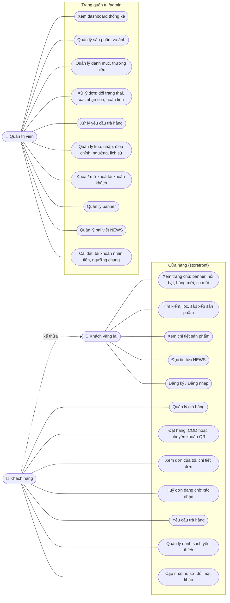

# Use case

Hệ thống có 3 tác nhân:

- **Khách vãng lai:** chưa đăng nhập.
- **Khách hàng:** đã đăng nhập, `role = customer`.
- **Quản trị viên:** `role = admin`.

Khách hàng làm được mọi việc của khách vãng lai. Tài khoản bị khoá không đăng nhập được, và nếu đang đăng nhập thì bị đăng xuất ở thao tác tiếp theo.

## Sơ đồ use case

## Danh sách use case

### Khách vãng lai / Khách hàng

| Mã | Use case | Mô tả ngắn |
|---|---|---|
| UC1 | Xem trang chủ | Slider banner, sản phẩm nổi bật, hàng mới, danh mục, tin mới. |
| UC2 | Tìm kiếm và lọc | Tìm theo tên hoặc SKU; lọc theo danh mục (danh mục cha gồm cả danh mục con), thương hiệu, độ tuổi, khoảng giá; sắp xếp mới nhất / giá tăng / giá giảm / bán chạy; phân trang. Bộ lọc nằm trên URL nên chia sẻ được link. |
| UC3 | Xem chi tiết sản phẩm | Ảnh, giá (giá gốc gạch ngang nếu đang khuyến mãi), tồn kho, mô tả, sản phẩm liên quan. |
| UC4 | Đọc NEWS | Danh sách bài đã xuất bản, bài ghim nổi bật, chi tiết bài. |
| UC5 | Đăng ký / Đăng nhập | Giới hạn 10 lần mỗi phút. Tài khoản bị khoá không đăng nhập được. |
| UC6 | Quản lý giỏ hàng | Thêm, đổi số lượng, xoá. Không cho vượt tồn kho; báo dòng nào đã hết hàng hoặc ngừng bán. |
| UC7 | Đặt hàng | Xem đặc tả bên dưới. |
| UC8 | Xem đơn của tôi | Lọc theo trạng thái; chi tiết có tiến trình đơn, mã QR (nếu chuyển khoản và chưa trả), yêu cầu trả hàng. |
| UC9 | Huỷ đơn | Chỉ khi đơn còn **Chờ xác nhận** và **chưa thanh toán**. Kho được hoàn lại. |
| UC10 | Yêu cầu trả hàng | Xem đặc tả bên dưới. |
| UC11 | Yêu thích | Thêm / bỏ từ thẻ sản phẩm hoặc trang chi tiết; xem danh sách. |
| UC12 | Hồ sơ | Sửa tên, số điện thoại; đổi mật khẩu (phải nhập mật khẩu cũ). |
| UC13 | Đổi giao diện, gọi hotline | Nút nổi góc dưới bên phải: chuyển sáng / tối (nhớ lựa chọn, lần đầu theo hệ điều hành); nút điện thoại di chuột hiện số hotline, bấm để gọi. Khách vãng lai cũng dùng được. |

### Quản trị viên

| Mã | Use case | Mô tả ngắn |
|---|---|---|
| AD1 | Dashboard | Doanh thu hôm nay / tháng này, đơn chờ xử lý, khách mới, sắp hết hàng; biểu đồ doanh thu 30 ngày / 12 tháng; top sản phẩm bán chạy; tỉ lệ trạng thái đơn. |
| AD2 | Sản phẩm | Tạo, sửa, ẩn, xoá mềm; tải nhiều ảnh, đổi thứ tự ảnh, xoá ảnh. Lọc theo danh mục, thương hiệu, trạng thái. |
| AD3 | Danh mục, thương hiệu | CRUD; không xoá được khi còn sản phẩm (danh mục: cả khi còn danh mục con). Danh mục có danh mục cha. |
| AD4 | Đơn hàng | Lọc, tìm theo mã hoặc tên; chuyển trạng thái theo đúng luồng; bấm **Đã nhận tiền** cho đơn chuyển khoản; bấm **Đã hoàn tiền** cho đơn đã huỷ sau khi khách trả tiền. |
| AD5 | Trả hàng | Duyệt hoặc từ chối (kèm lý do); xác nhận đã nhận hàng (chọn món nào nhập lại kho); ghi nhận đã hoàn tiền với số tiền thực hoàn. |
| AD6 | Kho | Danh sách tồn, lọc sắp hết / hết hàng; nhập kho hoặc điều chỉnh (kèm ghi chú); đặt ngưỡng riêng; xem lịch sử biến động. |
| AD7 | Người dùng | Tìm kiếm, khoá / mở khoá. Không tự khoá chính mình. |
| AD8 | Banner | CRUD, bật / tắt, sắp xếp thứ tự. |
| AD9 | NEWS | Soạn bài HTML (chèn ảnh), lưu nháp / xuất bản, ghim tin nổi bật. |
| AD10 | Cài đặt | Ngân hàng, số tài khoản, tên chủ tài khoản dùng để tạo QR; số hotline; ngưỡng sắp hết hàng chung. |

## Đặc tả các use case chính

### UC7 – Đặt hàng

- **Tác nhân:** Khách hàng.
- **Tiền điều kiện:** đã đăng nhập, giỏ có ít nhất 1 sản phẩm.
- **Luồng chính:**
  1. Khách mở trang Thanh toán. Hệ thống điền sẵn tên và số điện thoại từ hồ sơ.
  2. Khách nhập địa chỉ, ghi chú (tuỳ chọn), chọn **COD** hoặc **Chuyển khoản QR**, bấm Đặt hàng.
  3. Hệ thống, trong một transaction:
     - khoá các sản phẩm trong giỏ;
     - kiểm tra lại tồn kho và trạng thái đang bán;
     - tạo đơn, lưu lại giá và tên sản phẩm;
     - trừ kho và ghi lịch sử kho;
     - xoá giỏ.
  4. Hệ thống chuyển tới trang Đặt hàng thành công. Nếu chọn chuyển khoản, trang hiện ảnh VietQR có sẵn số tiền và nội dung là mã đơn.
- **Luồng ngoại lệ:**
  - 3a. Có sản phẩm hết hàng, không đủ số lượng hoặc đã ngừng bán: không tạo đơn, kho giữ nguyên. Hệ thống báo từng sản phẩm lỗi và đưa nút quay về giỏ.
  - 3b. Hai khách cùng mua món cuối cùng: nhờ khoá dòng sản phẩm, chỉ một người đặt được, người còn lại nhận lỗi 3a.
- **Hậu điều kiện:** đơn ở trạng thái **Chờ xác nhận**, chưa thanh toán; tồn kho đã giảm.

### UC9 – Huỷ đơn (khách)

- **Tiền điều kiện:** đơn của chính khách, trạng thái **Chờ xác nhận**, chưa thanh toán.
- **Luồng chính:** khách bấm Huỷ đơn, xác nhận. Hệ thống chuyển đơn sang **Đã huỷ** và cộng lại kho (lý do `cancel`).
- **Ngoại lệ:**
  - Đơn đã được xác nhận: báo khách liên hệ cửa hàng.
  - Đơn đã thanh toán: báo khách liên hệ cửa hàng để cửa hàng huỷ và hoàn tiền.
  - Bấm huỷ hai lần: lần sau bị từ chối, kho không bị cộng hai lần.

### AD4 – Xử lý đơn hàng (admin)

- **Luồng chính:**
  - Admin mở chi tiết đơn. Hệ thống chỉ hiện các nút chuyển trạng thái hợp lệ: Xác nhận → Bắt đầu giao → Đã giao xong.
  - Khi đơn **Hoàn thành**: ghi `completed_at`; nếu là COD thì tự đánh dấu đã thanh toán (shipper đã thu tiền).
- **Thanh toán chuyển khoản:** admin kiểm tra tài khoản ngân hàng, thấy tiền về đúng mã đơn thì bấm **Đã nhận tiền**. Hệ thống không tự kiểm tra giao dịch.
- **Huỷ:** admin huỷ được khi đơn **Chờ xác nhận** hoặc **Đã xác nhận**; kho được hoàn. Nếu khách đã trả tiền, đơn hiện nhắc **Cần hoàn tiền** cho tới khi admin bấm **Đã hoàn tiền**.
- **Ngoại lệ:** chuyển sai luồng (VD: Hoàn thành → Đang giao) bị từ chối với thông báo rõ.

### UC10 / AD5 – Trả hàng và hoàn tiền

- **Tiền điều kiện:** đơn **Hoàn thành**, còn trong hạn `RETURN_DAYS` ngày (mặc định 10) kể từ ngày hoàn thành, không có yêu cầu nào khác đang mở.
- **Luồng chính:**
  1. Khách chọn sản phẩm và số lượng muốn trả, chọn lý do, tải 1–5 ảnh hoặc video minh chứng, nhập tài khoản nhận tiền hoàn.
  2. Admin xem minh chứng, **duyệt** hoặc **từ chối** (bắt buộc nhập lý do).
  3. Khách gửi hàng về. Admin bấm **Đã nhận hàng**, chọn món nào còn bán được để nhập lại kho (lý do `return`).
  4. Admin chuyển tiền cho khách ngoài hệ thống, rồi bấm **Đã hoàn tiền** với số tiền thực hoàn:
     - mặc định = tiền hàng các món trả, không gồm phí ship;
     - tối đa = tổng đơn trừ các lần đã hoàn trước đó.
- **Ngoại lệ:**
  - Số lượng trả vượt số còn trả được.
  - Quá hạn trả hàng.
  - File sai định dạng hoặc quá dung lượng.
- **Hậu điều kiện:** số tiền hoàn bị trừ khỏi doanh thu vào ngày hoàn tiền.
